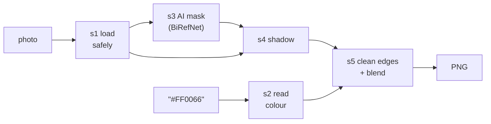

# bgchange

Put a **person or product photo on a new background colour**, with clean edges
and the **subject's shadow**: a command-line tool, with an optional web page.

```bash
uv run bgchange photo.jpg --color "#FF0066"
```


- **AI cut-out:** [BiRefNet](https://github.com/ZhengPeng7/BiRefNet), chosen after benchmarking 5 models on 970 photos ([why](docs/05-benchmark.md)).
- **Clean edges:** no halo of the old background around hair or fur.
- **Shadow:** the photo's real shadow (default), a computed one, both, or none.
- **Any hex colour**, including transparent (`#00000000` gives a cut-out PNG).

---

## 1. Setup (once)

Needs [git](https://git-scm.com/) and [uv](https://docs.astral.sh/uv/getting-started/installation/)
(uv installs Python 3.12 by itself). An NVIDIA GPU is optional: it is used
automatically if present (~2 s per photo), otherwise the CPU (~20 s).

```bash
git clone https://github.com/Maher-bouchrara/bg-changer-MODELIA.git
cd bg-changer-MODELIA
uv sync
uv run python scripts/download_models.py birefnet
```

`uv sync` installs the Python packages; the last line downloads the AI model
(425 MB, once). Check that everything works: `uv run pytest` (133 tests, no GPU needed).

## 2. CLI guide (the main way to use it)

```bash
uv run bgchange photo.jpg --color "#FF0066"
```

The result is saved as `outputs/photo_on_FF0066.png`, same size as the photo.

| Option | What it does | Default |
|---|---|---|
| `--color` | New background: `#RGB`, `#RRGGBB` or `#RRGGBBAA` (keep the quotes) | required |
| `--shadow` | `real` (the photo's own), `fake` (computed), `mix` (both), `none` | `real` |
| `--shadow-strength` | `0` (none) to `1` (as in the photo) | `1` |
| `-o` | Output file | `outputs/<photo>_on_<HEX>.png` |
| `--model` | `birefnet`, `ben2`, `inspyrenet`, `birefnet-matting`, `rmbg-2.0` (non-commercial) | `birefnet` |
| `--no-edge-cleanup` | Skip the edge cleanup, to compare | off |
| `--device` | `auto`, `cuda`, `cpu` | `auto` |

```bash
uv run bgchange shoe.jpg --color "#E4E0D8" --shadow mix --shadow-strength 0.7
uv run bgchange portrait.jpg --color "#00000000" -o cutout.png
uv run bgchange --help
```

Other models must be downloaded first: `uv run python scripts/download_models.py ben2`.

## 3. Web interface (optional): backend + frontend

An easier way for people who don't use a terminal. It gives the **same results
as the CLI** (both call the same function).


**Backend** (FastAPI), in a first terminal:

```bash
uv run bgchange-api
```

| Route | What it does |
|---|---|
| `GET /api/health` | Is the API up, is the model loaded? |
| `POST /api/change-background` | Photo + colour (+ shadow options) → the PNG |

Interactive documentation: <http://127.0.0.1:8000/docs>. Details: [docs/08b-api.md](docs/08b-api.md).

**Frontend** (Next.js), in a second terminal (needs [Node.js](https://nodejs.org/) 20.9 or newer):

```bash
cd frontend
npm install
npm run dev
```

Open <http://localhost:3000>. `npm install` only the first time (~380 MB).

## 4. Docker (optional): everything with one command

No Python or Node needed, only [Docker Desktop](https://www.docker.com/products/docker-desktop/).
Runs on the CPU, so it works on any computer (~20 s per photo).

```bash
docker compose up --build
```

Open <http://localhost:3000>. The model is downloaded on the first start if it
isn't already in `models/`. The CLI works in Docker too:

```bash
docker compose run --rm -v "${PWD}:/work" api bgchange /work/photo.jpg --color "#FF0066" -o /work/out.png
```

Stop with `Ctrl + C` or `docker compose down`. Details: [docs/10-docker.md](docs/10-docker.md).

---

## How it works



| Step | Folder | What it does |
|---|---|---|
| s1 | `bgchange/s1_load_photo/` | Opens any image safely: rotates phone photos upright, converts CMYK, 16-bit, colour profiles |
| s2 | `bgchange/s2_read_color/` | `"#FF0066"` → red 255, green 0, blue 102 (+ transparency) |
| s3 | `bgchange/s3_ai_models/` | The AI gives a mask: how much each pixel is subject (0 to 1). The only neural network |
| s4 | `bgchange/s4_shadow/` | Measures how much darker the floor is near the subject's base, or computes a soft shadow |
| s5 | `bgchange/s5_new_background/` | Removes the old background's colour from the edges, then mixes photo and colour with the mask, in linear light |

`bgchange/pipeline.py` runs the 5 steps; the CLI (`cli.py`) and the API
(`api/`) are thin layers on top of it.

## The project, step by step

Each step has its own page in [docs/](docs/README.md): what was built, a diagram, the decisions and what went wrong.

| # | Step | Doc |
|---|---|---|
| 1 | Repo baseline | [01](docs/01-repo-baseline.md) |
| 2 | GPU setup and the first model | [02](docs/02-gpu-and-first-model.md) |
| 3 | Loading photos safely, reading hex colours | [03](docs/03-input-handling.md) |
| 4 | 5 segmentation models behind one interface | [04](docs/04-segmentation-models.md) |
| 5 | Benchmark on 970 photos + eye test on 62 → BiRefNet | [05](docs/05-benchmark.md) |
| 6a | Compositing in linear light | [06](docs/06-compositing.md) |
| 6b | Edge cleanup | [06b](docs/06b-edge-cleanup.md) |
| 6c | Shadows: real, fake, mix, none | [06c](docs/06c-shadows.md) |
| 8a | The `bgchange` command | [08a](docs/08a-cli.md) |
| 8b | The web API | [08b](docs/08b-api.md) |
| 9 | The web page | [09](docs/09-web-page.md) |
| 10 | Docker | [10](docs/10-docker.md) |

## Limitations

- **Ambiguous subjects:** in "a person holding a cup", the AI may keep only the cup.
- **Real shadow on busy photos:** small smudges of floor texture can remain near the feet; `--shadow fake` or `none` is cleaner there.
- **Edge cleanup** can add a soft glow where the AI's mask is blurry; `--no-edge-cleanup` turns it off.
- **CPU is slow** (~20 s per photo vs ~2 s on a GPU). Docker runs on the CPU.
- **RMBG-2.0** is non-commercial (CC BY-NC 4.0): available, never the default.

## Time spent and use of AI

See [NOTES.md](NOTES.md).
