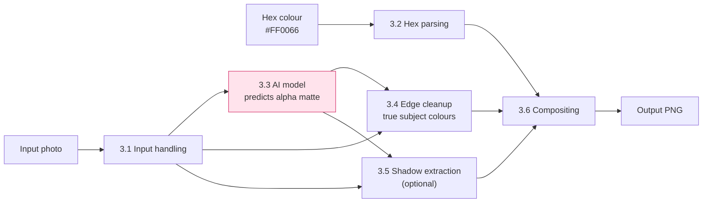
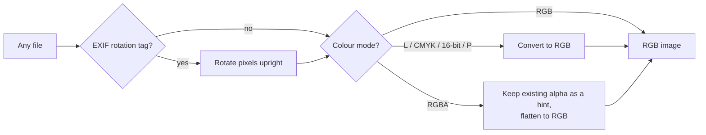
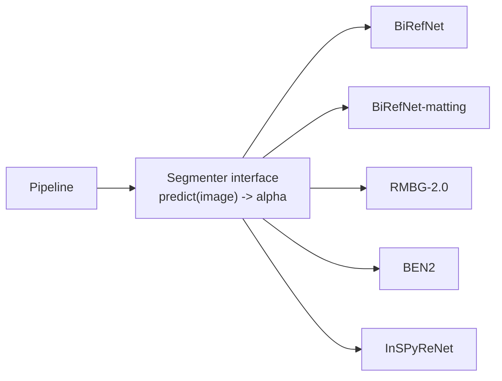
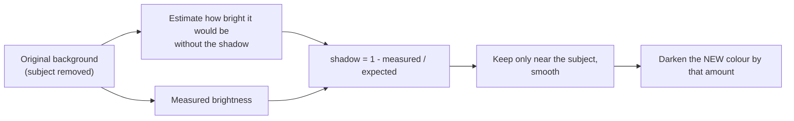
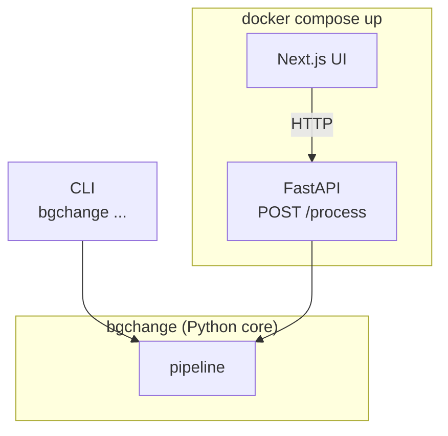

# Bg-changer

Put a person or product photo on a new solid-colour background, and optionally
**keep the subject's real shadow** on the new colour.

```
photo.jpg + "#FF0066"  ──►  same photo, same subject, pink background (+ shadow)
```

> **Status:** work in progress. Sections marked 🚧 are planned and are filled in
> as each step is committed. See [Roadmap](#roadmap).

---

## Contents

1. [Quick start](#quick-start)
2. [How it works (the pipeline)](#how-it-works-the-pipeline)
3. [Decisions, step by step](#decisions-step-by-step)
   - [3.1 Input handling](#31-input-handling)
   - [3.2 Hex colour parsing](#32-hex-colour-parsing)
   - [3.3 Segmentation models](#33-segmentation-models)
   - [3.4 Edge cleanup (foreground estimation)](#34-edge-cleanup-foreground-estimation)
   - [3.5 Shadow extraction](#35-shadow-extraction)
   - [3.6 Compositing](#36-compositing)
   - [3.7 Architecture: CLI, API, UI](#37-architecture-cli-api-ui)
4. [Results](#results)
5. [What did not work / limitations](#what-did-not-work--limitations)
6. [Roadmap](#roadmap)
7. [Time spent and use of AI tools](#time-spent-and-use-of-ai-tools)

---

## Quick start

🚧 Filled in once the CLI and Docker Compose exist. The target is one command each:

```bash
docker compose up
```

```bash
uv run bgchange photo.jpg --color "#FF0066" --shadow keep -o out.png
```

---

## How it works (the pipeline)

The AI model does **one** job: it says, for every pixel, *how much of this pixel
is the subject* (a number from 0 to 1 called the **alpha matte**). Everything
else (reading the file, the colour, the shadow, the blend) is ordinary image
processing written in this repo.



Only the pink box is a neural network. That separation is deliberate: the model
can be swapped (see 3.3) without touching any other stage.

---

## Decisions, step by step

Each section answers three questions: **what is the problem**, **what did I
choose**, and **why**.

### 3.1 Input handling

🚧 *Implemented in step 2.*

**Problem.** Real photos are messier than they look. A phone photo is often
stored sideways, with a tag (EXIF) telling viewers to rotate it. Files can be
greyscale, CMYK (print), 16-bit, or already have transparency.

**Plan.**



**Why.** Skipping the EXIF step would give a correctly cut-out subject lying on
its side. Everything downstream assumes a plain 8-bit RGB image, so this step
is the single place that guarantees it.

### 3.2 Hex colour parsing

🚧 *Implemented in step 2.*

**Plan.** Accept the formats people actually type, reject everything else with
a clear message.

| Input | Meaning | Result |
|---|---|---|
| `#F06` | short form | `(255, 0, 102)` |
| `#FF0066` | standard | `(255, 0, 102)` |
| `FF0066` | no `#` | accepted |
| `#FF006680` | with alpha | 50 % transparent background → PNG with transparency |
| `#00000000` | fully transparent | a plain cut-out |
| `red`, `#GG0000` | invalid | error explaining the accepted formats |

### 3.3 Segmentation models

🚧 *Implemented in steps 3–4, chosen by the benchmark in step 5.*

**What a model does here.** Image in, alpha matte out. Nothing else.

```
 photo                alpha matte (white = subject)
 ┌──────────┐         ┌──────────┐
 │  🧍 on    │  model  │  ⬜ on    │
 │  street  │ ──────► │  ⬛ black │
 └──────────┘         └──────────┘
```

**Plan.** All models sit behind one small interface, so you choose with
`--model <name>` and the rest of the pipeline never changes.



| Model | Why it is in the list | License |
|---|---|---|
| BiRefNet (general) | Suggested in the brief; strong open state of the art | MIT |
| BiRefNet-matting | Same family, trained for soft edges (hair) | MIT |
| RMBG-2.0 (BRIA) | Very strong on products | **Non-commercial**: benchmarked, not shipped as default |
| BEN2 | Strong on hair and fine edges | 🚧 to verify |
| InSPyReNet | Strong at high resolution | MIT |

Only one model is loaded on the GPU at a time, so 8 GB of VRAM is enough.
Weights are downloaded on first use into a cache and never committed.

### 3.4 Edge cleanup (foreground estimation)

🚧 *Implemented in step 6.*

**Problem.** Along hair and soft edges, pixels are a *mix* of subject and old
background. Pasting them as-is onto pink leaves a green fringe if the old
background was grass.

**Plan.** Before blending, estimate the subject's *true* colour at each edge
pixel (removing the old background's contribution), then blend that.

### 3.5 Shadow extraction

🚧 *Implemented in step 7.*

**Problem.** The model marks the shadow as "not subject", so a normal cut-out
loses it and the subject looks pasted on.

**Plan.** A shadow is the background made darker. So:



Options: `--shadow none|keep` and `--shadow-strength 0..1`. On very busy
backgrounds the shadow cannot be separated reliably; the tool detects this and
warns instead of producing a dirty result.

### 3.6 Compositing

🚧 *Implemented in step 6.*

The standard blend, one line per pixel:

```
result = alpha × subject + (1 − alpha) × (new colour × shadow darkening)
```

### 3.7 Architecture: CLI, API, UI

🚧 *Implemented in steps 8–10.*



The CLI and API are thin wrappers, so both give identical results.

---

## Results

🚧 Contact sheet of the hard cases (original / mask / result / result + shadow)
and the benchmark table go here.

## What did not work / limitations

🚧 Filled in honestly as things fail.

## Roadmap

Each step is one or more small commits.

- [x] **1. Repo baseline**: structure, README plan, notes
- [ ] **2. Input handling + hex parsing** (with tests)
- [ ] **3. Python env + GPU check + first model (BiRefNet)**
- [ ] **4. Model registry + the other 4 models**
- [ ] **5. Benchmark** → pick the default model
- [ ] **6. Edge cleanup + compositing** → first full CLI result
- [ ] **7. Shadow extraction**
- [ ] **8. FastAPI**
- [ ] **9. Next.js UI**
- [ ] **10. Docker Compose** (CPU default, GPU profile)
- [ ] **11. Results, limitations, final README**

## Time spent and use of AI tools

Tracked as I go in [NOTES.md](NOTES.md).
