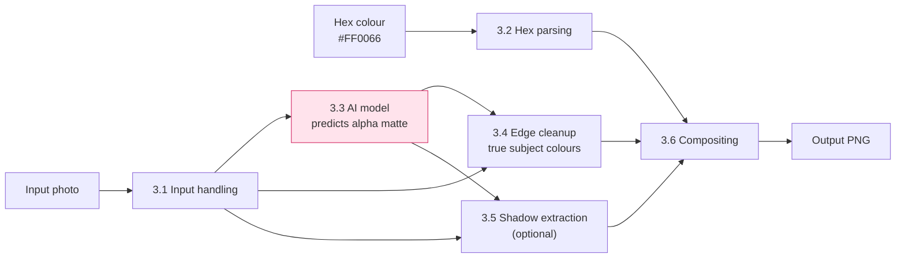
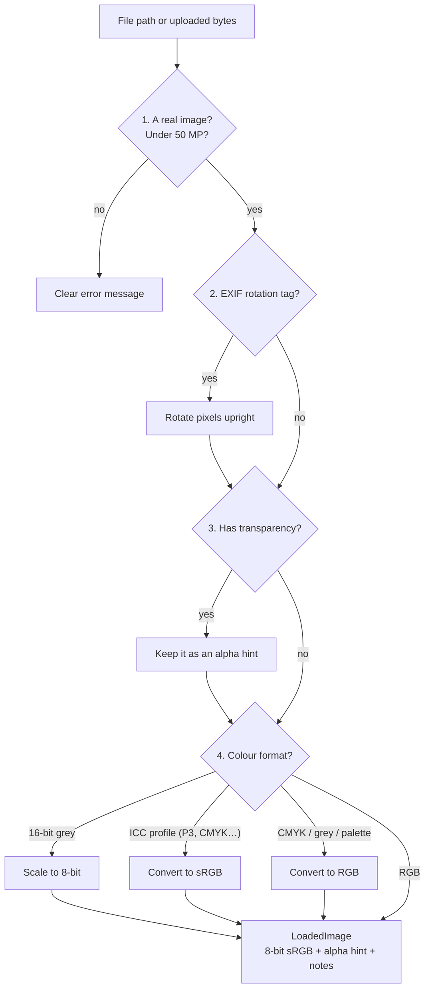
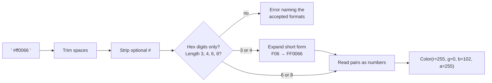
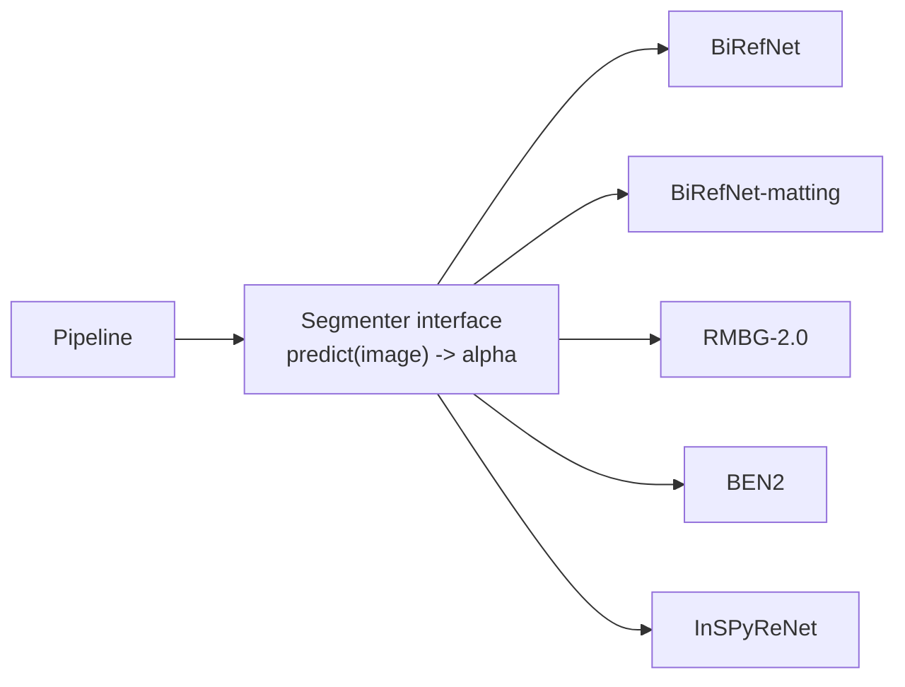
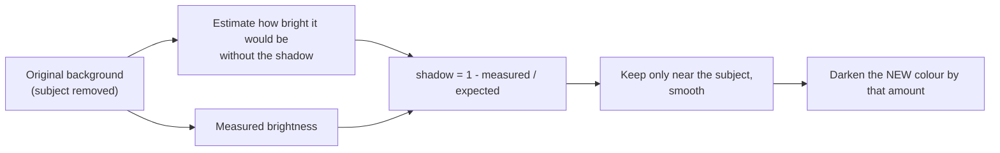
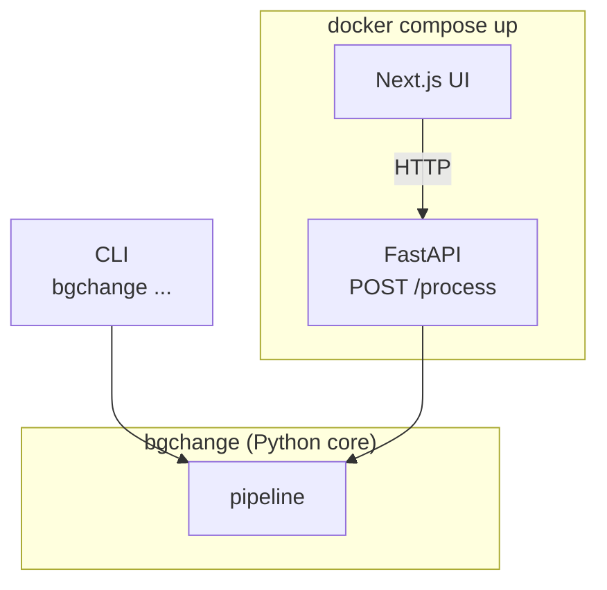

# Bg-changer

Put a person or product photo on a new solid-colour background, and optionally
**keep the subject's real shadow** on the new colour.

```
photo.jpg + "#FF0066"  ──►  same photo, same subject, pink background (+ shadow)
```

> **Status:** work in progress. Sections marked 🚧 are planned and are filled in
> as each step is committed. See [Roadmap](#roadmap).

---

## Contents

1. [Quick start](#quick-start)
2. [How it works (the pipeline)](#how-it-works-the-pipeline)
3. [Decisions, step by step](#decisions-step-by-step)
   - [3.1 Input handling](#31-input-handling)
   - [3.2 Hex colour parsing](#32-hex-colour-parsing)
   - [3.3 Segmentation models](#33-segmentation-models)
   - [3.4 Edge cleanup (foreground estimation)](#34-edge-cleanup-foreground-estimation)
   - [3.5 Shadow extraction](#35-shadow-extraction)
   - [3.6 Compositing](#36-compositing)
   - [3.7 Architecture: CLI, API, UI](#37-architecture-cli-api-ui)
4. [Results](#results)
5. [What did not work / limitations](#what-did-not-work--limitations)
6. [Roadmap](#roadmap)
7. [Time spent and use of AI tools](#time-spent-and-use-of-ai-tools)

---

## Quick start

🚧 Filled in once the CLI and Docker Compose exist. The target is one command each:

```bash
docker compose up
```

```bash
uv run bgchange photo.jpg --color "#FF0066" --shadow keep -o out.png
```

---

## How it works (the pipeline)

The AI model does **one** job: it says, for every pixel, *how much of this pixel
is the subject* (a number from 0 to 1 called the **alpha matte**). Everything
else (reading the file, the colour, the shadow, the blend) is ordinary image
processing written in this repo.



Only the pink box is a neural network. That separation is deliberate: the model
can be swapped (see 3.3) without touching any other stage.

---

## Decisions, step by step

Each section answers three questions: **what is the problem**, **what did I
choose**, and **why**.

### 3.1 Input handling

✅ *[`bgchange/io.py`](bgchange/io.py), 16 tests in [`tests/test_io.py`](tests/test_io.py).*

**Problem.** Real photos are messier than they look. A phone photo is often
stored sideways, with a tag (EXIF) telling viewers to rotate it. Files can be
greyscale, CMYK (print), 16-bit, carry a colour profile, or already have
transparency.

**What `load_image()` does.** It takes a file path (CLI) or raw bytes (API) and
always returns the same thing: an upright, 8-bit sRGB image.



| Hard case | What would go wrong without it | Fix |
|---|---|---|
| Phone photo with EXIF rotation | Subject processed and returned lying on its side | Rotate the pixels, drop the tag |
| 16-bit greyscale PNG | Pillow's `convert("L")` *clips* instead of scaling, so mid-grey becomes white | Scale by hand (÷257) |
| iPhone photo (Display-P3) | Colours read as sRGB look washed out | Convert with the embedded ICC profile |
| CMYK print JPEG | Model expects RGB | Use the ICC profile if present, else Pillow's formula |
| PNG already partly transparent | That information would be lost | Kept as an *alpha hint* for compositing |
| Animated GIF / multi-page TIFF | Ambiguous input | First frame, with a note |
| Not an image, truncated download | Crash with a Python traceback | One clear error message |
| 20,000 × 20,000 image, decompression bomb | Freezes the machine | Refused **before** decoding (limit 50 MP) |
| Broken colour profile | Good photo rejected | Profile ignored, with a note |

**Design choices.**
- **Nothing happens silently.** Every fix adds a line to `notes`, and the CLI and
  API show them, so a user can see *why* the output looks the way it does.
- **Transparency is removed before colour conversion**, because colour profiles
  apply to colour channels only.
- **All test images are generated in code.** No binary test files in the repo,
  and each test triggers exactly one problem.

### 3.2 Hex colour parsing

✅ *[`bgchange/color.py`](bgchange/color.py), 27 tests in [`tests/test_color.py`](tests/test_color.py).*

**What `parse_hex_color()` does.** It accepts the formats people actually type
and rejects everything else with a message that says what to type instead.



| Input | Meaning | Result |
|---|---|---|
| `#FF0066`, `#ff0066`, `FF0066`, `" #FF0066 "` | standard, any case, `#` optional | `(255, 0, 102)` solid |
| `#F06` | short form | `(255, 0, 102)` solid |
| `#FF006680` / `#F068` | with alpha | semi-transparent background → PNG with transparency |
| `#00000000` | fully transparent | a plain cut-out |
| `red`, `#GG0000`, `#FF006`, empty | invalid | error listing the accepted formats |

**Design choices.**
- **No colour names** (`red`, `navy`). The brief asks for hex, and one strict
  format is easier to test and explain.
- **Known trap: `#FF00` is not a typo error.** It's a valid `#RGBA` short form,
  which means *fully transparent yellow*. It follows the CSS standard, so it is
  accepted, and a test pins down this behaviour.

### 3.3 Segmentation models

🚧 *BiRefNet in step 2, the other models in step 4, the default chosen by the benchmark in step 5.*

**What a model does here.** Image in, alpha matte out. Nothing else.

```
 photo                alpha matte (white = subject)
 ┌──────────┐         ┌──────────┐
 │  🧍 on    │  model  │  ⬜ on    │
 │  street  │ ──────► │  ⬛ black │
 └──────────┘         └──────────┘
```

**Plan.** All models sit behind one small interface, so you choose with
`--model <name>` and the rest of the pipeline never changes.



| Model | Why it is in the list | License |
|---|---|---|
| BiRefNet (general) | Suggested in the brief; strong open state of the art | MIT |
| BiRefNet-matting | Same family, trained for soft edges (hair) | MIT |
| RMBG-2.0 (BRIA) | Very strong on products | **Non-commercial**: benchmarked, not shipped as default |
| BEN2 | Strong on hair and fine edges | 🚧 to verify |
| InSPyReNet | Strong at high resolution | MIT |

Only one model is loaded on the GPU at a time, so 8 GB of VRAM is enough.
Weights are downloaded on first use into a cache and never committed.

**Pinned versions.** BiRefNet's architecture is Python code stored in its
Hugging Face repo and executed locally (`trust_remote_code`). The code is pinned
to the exact Hub commit that was tested, so an upstream change cannot silently
alter results or run unreviewed code.

**First measurements (BiRefNet, RTX 5050 Laptop, fp16, 1024×1024 input):**

| | Value |
|---|---|
| Load from cache | ~9 s (first download ~3 min) |
| First prediction (GPU warm-up) | ~1.3 s |
| Following predictions | **~0.35 s** |
| Peak VRAM | **1.6 GB** |

Check your own machine:

```bash
uv run python scripts/check_gpu.py
```

```bash
uv run python scripts/predict_mask.py photo.jpg
```

### 3.4 Edge cleanup (foreground estimation)

🚧 *Implemented in step 6.*

**Problem.** Along hair and soft edges, pixels are a *mix* of subject and old
background. Pasting them as-is onto pink leaves a green fringe if the old
background was grass.

**Plan.** Before blending, estimate the subject's *true* colour at each edge
pixel (removing the old background's contribution), then blend that.

### 3.5 Shadow extraction

🚧 *Implemented in step 7.*

**Problem.** The model marks the shadow as "not subject", so a normal cut-out
loses it and the subject looks pasted on.

**Plan.** A shadow is the background made darker. So:



Options: `--shadow none|keep` and `--shadow-strength 0..1`. On very busy
backgrounds the shadow cannot be separated reliably; the tool detects this and
warns instead of producing a dirty result.

### 3.6 Compositing

🚧 *Implemented in step 6.*

The standard blend, one line per pixel:

```
result = alpha × subject + (1 − alpha) × (new colour × shadow darkening)
```

### 3.7 Architecture: CLI, API, UI

🚧 *Implemented in steps 8–10.*



The CLI and API are thin wrappers, so both give identical results.

---

## Results

🚧 Contact sheet of the hard cases (original / mask / result / result + shadow)
and the benchmark table go here.

## What did not work / limitations

🚧 Filled in honestly as things fail.

## Roadmap

Each step is one or more small commits.

- [x] **1. Repo baseline**: structure, README plan, notes
- [x] **2. Python env + GPU check + first model (BiRefNet)**
- [x] **3. Input handling + hex parsing** (43 tests)
- [ ] **4. Model registry + the other 4 models**

> **Why the model comes before input handling.** Getting PyTorch to run on a
> brand-new GPU and loading the model is the riskiest part, so it is done first
> to surface problems early. Input handling and hex parsing are plain Python and
> low risk.

Run the tests (no GPU or downloads needed):

```bash
uv run pytest
```
- [ ] **5. Benchmark** → pick the default model
- [ ] **6. Edge cleanup + compositing** → first full CLI result
- [ ] **7. Shadow extraction**
- [ ] **8. FastAPI**
- [ ] **9. Next.js UI**
- [ ] **10. Docker Compose** (CPU default, GPU profile)
- [ ] **11. Results, limitations, final README**

## Time spent and use of AI tools

Tracked as I go in [NOTES.md](NOTES.md).
