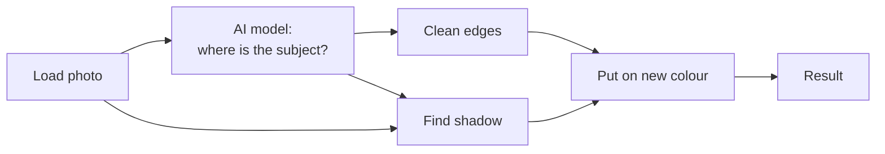

# Step 1: Repo baseline

**Goal:** a clean starting point. The structure, the plan and the rules come
before any code.

## What was built

```
Bg-changer/
├── README.md        the plan: pipeline diagram, one section per decision, roadmap
├── NOTES.md         working log: hours, decisions in progress, AI use
├── .gitignore       keeps weights, test images, results and secrets out of git
├── .python-version  3.12
├── bgchange/        the Python package (empty at this point)
├── examples/        list of hard cases to test with
└── benchmarks/      plan for the model comparison
```

## The plan, as a pipeline



## Decisions and why

| Decision | Why |
|---|---|
| **Plan in the README first** | The brief asks for "the decisions you made and why". Writing the sections first meant every later step had a place to put its explanation. |
| **Python 3.12, not the system's 3.14** | PyTorch CUDA builds are reliably available for 3.12; 3.14 is too new. |
| **Small, frequent commits** | The brief grades the commit history. Each commit is one understandable change. |
| **Large files never in git** | Model weights (3 GB) and test images (0.7 GB) are downloaded by scripts, pinned to exact versions, so the repo stays small and reproducible. |
| **NOTES.md from day one** | Hours and AI use are part of the submission; logging them as I go keeps them honest. |

## Result

Commit `06c0fbe`. The roadmap went from 11 open steps to the first one checked.
