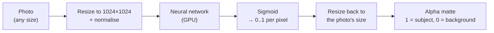

# Step 2: GPU and the first model (BiRefNet)

**Goal:** prove the riskiest part works before anything else: PyTorch on a
brand-new GPU, and one model producing a mask.

## Why this step came before input handling

The original order was "input handling first". It was swapped because a
failure here (wrong PyTorch build, model not loading) could cost hours, while
input handling is plain Python with little risk. Finding problems early is
cheaper.

## What was built

```
pyproject.toml                  dependencies; PyTorch from the CUDA 12.8 index
bgchange/device.py              GPU if available, else CPU; fp16 on GPU
bgchange/segmenters/base.py     the rule every model follows: predict(image) -> alpha
bgchange/segmenters/birefnet.py BiRefNet
scripts/check_gpu.py            what PyTorch sees + a real GPU computation
scripts/predict_mask.py         save the mask of one photo
```

## What a model does here



The model only answers "how much of each pixel is the subject". Everything
else (colour, shadow, blending) is our code.

## Decisions and why

| Decision | Why |
|---|---|
| **PyTorch from the CUDA 12.8 index** | The RTX 5050 is a Blackwell GPU (`sm_120`). Older PyTorch builds fail with "no kernel image available". PyPI's Windows wheels are CPU-only. |
| **fp16 on GPU, fp32 on CPU** | Half precision halves memory and is faster on GPUs, with no visible change in the mask. CPUs are slow at fp16. |
| **Automatic CPU fallback** | The reviewers may not have an NVIDIA GPU. The tool must still run. |
| **Pin the model to an exact Hub commit** | BiRefNet's network is Python code downloaded from Hugging Face and executed (`trust_remote_code`). Pinning means an upstream change can't alter results or run new, unreviewed code. transformers itself warned about this. |

## Measurements (RTX 5050 Laptop)

| | Value |
|---|---|
| PyTorch | 2.11.0, CUDA 12.8, GPU `sm_120` |
| First download | ~3 min |
| Load from cache | ~9 s |
| Per photo | **~0.35 s** |
| Peak GPU memory | **1.6 GB** of 8 GB |

## Run it

```bash
uv run python scripts/check_gpu.py
```

```bash
uv run python scripts/predict_mask.py photo.jpg
```

## Result

Commit `dd89833`. The model was first verified on a synthetic image (red disc
on grey: disc = 1.0, background ≈ 0).
