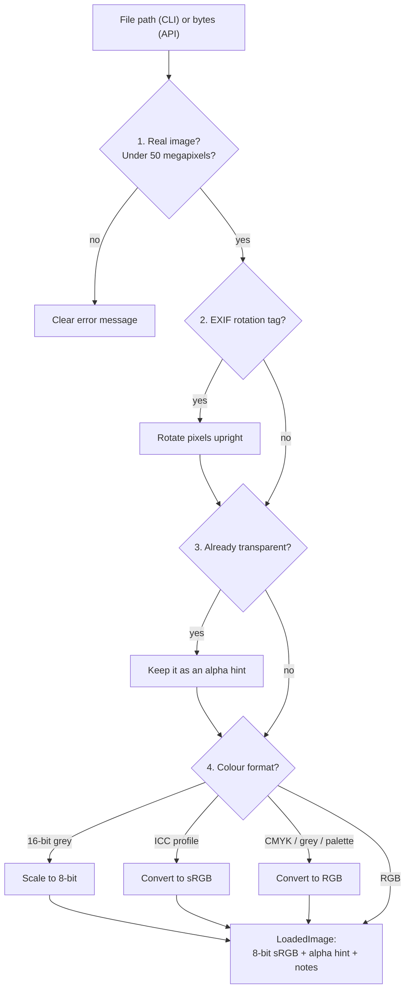
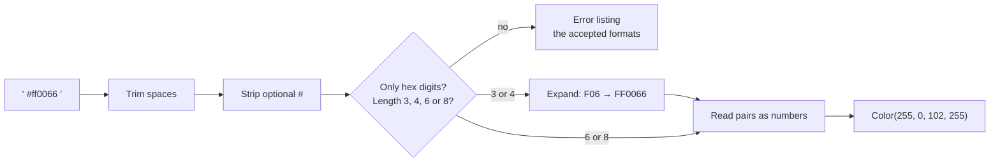

# Step 3: Input handling and hex colour parsing

**Goal:** turn the user's two inputs (a photo file and a colour text) into
values the rest of the pipeline can trust, and reject bad input with a clear
message instead of a crash.

```
bgchange photo.jpg  --color "#FF0066"
         ─────────          ─────────
         bgchange/io/       bgchange/color/
```

The two inputs never depend on each other, so each has its own folder, with
**one file per step** so every file can be read on its own.

## Part 1: loading the photo (`bgchange/io/`)

```
bgchange/io/
├── loader.py          load_image(): runs the 4 steps below, in order
├── open_file.py       1. open + validate
├── exif_rotation.py   2. rotate phone photos upright
├── transparency.py    3. keep existing transparency as a hint
├── color_mode.py      4. convert to 8-bit sRGB, helped by:
├── bit_depth.py          · 16-bit greyscale → 8-bit
├── color_profile.py      · ICC profiles (iPhone P3, CMYK) → sRGB
└── errors.py          ImageLoadError
```



### The hard cases it handles

| Hard case | What goes wrong without it | Fix |
|---|---|---|
| Phone photo with EXIF rotation | Subject processed lying on its side | Rotate the pixels |
| 16-bit greyscale PNG | Pillow's `convert("L")` **clips**: mid-grey (32768) becomes white | Scale by hand (÷257) |
| iPhone photo (Display-P3) | Colours look washed out | Convert with the embedded ICC profile |
| CMYK print JPEG | Model expects RGB | ICC profile if present, else Pillow's formula |
| PNG already partly transparent | That information is lost | Kept as an *alpha hint* |
| Animated GIF / multi-page TIFF | Ambiguous input | First frame, with a note |
| Not an image, truncated download | Python traceback | One clear error message |
| Huge image / "decompression bomb" | Freezes the machine | Refused **before** decoding (50 MP limit) |
| Broken colour profile | Good photo rejected | Profile ignored, with a note |

Every fix adds a sentence to `notes`, so nothing happens silently.

## Part 2: parsing the colour (`bgchange/color/`)

```
bgchange/color/
├── rgba.py         Color(r, g, b, a): the value the pipeline uses
├── hex_parser.py   parse_hex_color(): "#FF0066" → Color(255, 0, 102, 255)
└── errors.py       ColorParseError
```



| Input | Result |
|---|---|
| `#FF0066`, `ff0066`, `" #FF0066 "` | solid pink |
| `#F06` | same, short form |
| `#FF006680` | 50% transparent background → PNG with transparency |
| `red`, `#GG0000`, `#FF006` | error naming the accepted formats |

## Decisions and why

| Decision | Why |
|---|---|
| **One loader for CLI and API** | Both accept the same files and behave identically. |
| **Transparency split off before colour conversion** | Colour profiles apply to colour channels only. |
| **No colour names ("red")** | The brief asks for hex; one strict format is easier to test and explain. |
| **Test images generated in code** | No binary test files in the repo; each test triggers exactly one problem. |
| **One file per step** | Each step can be read, tested and changed alone. |

## Problem found: a test caught my own mistake

I first listed `#FF00` as an invalid colour. A test proved it is **valid**: it's
the short `#RGBA` form, meaning *fully transparent yellow*. It follows the CSS
standard, so it's accepted, and a test pins the behaviour as a known trap.

## Run the tests

```bash
uv run pytest tests/io tests/color
```

## Result

Commits `1bb0459`, `1ade4db`, `3f46958`, `3edba8a`. 48 tests at the end of the step.
