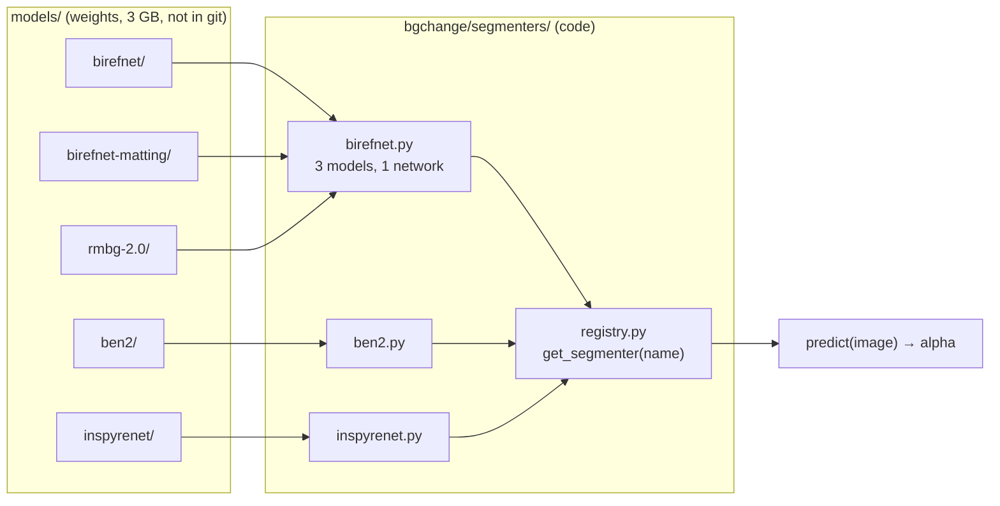

# Step 4: The 5 segmentation models and the registry

**Goal:** make five models usable through one interface, so they can be
compared fairly and swapped with a single name.

## Downloaded is not the same as usable



The weights are just numbers. Each model needs a small **adapter** that builds
its network, loads the weights, prepares the photo the way that model expects,
and converts its output into a 0–1 matte.

## The 5 models

| Name | How it works | Licence |
|---|---|---|
| `birefnet` | Looks twice: whole scene small + full detail | MIT |
| `birefnet-matting` | Same network, trained on soft edges (hair) | MIT |
| `rmbg-2.0` | Same network, trained by BRIA on licensed product/people photos | **CC BY-NC 4.0, non-commercial** |
| `ben2` | 4 zoomed tiles + 1 overview, merged | MIT |
| `inspyrenet` | Rough mask first, then adds edge detail level by level | MIT |

`birefnet`, `birefnet-matting` and `rmbg-2.0` share one adapter: their
`config.json` files all declare the same `BiRefNet` architecture.

## The registry

Like a phone's contact list: ask for a name, get a ready model.

```python
from bgchange.segmenters import get_segmenter
alpha = get_segmenter("ben2").predict(image)
```

- The same name again reuses the loaded model instantly.
- A different name **unloads the previous model first**, so 8 GB of GPU memory is always enough.
- A wrong name lists the valid ones.
- It's thread-safe, for the API later.

## Problems found (by reading each model's code before wrapping it)

| Problem | Fix |
|---|---|
| **BEN2 and InSPyReNet stretch their masks min-to-max** in their own helpers, which turns an unsure prediction into a confident-looking one | Adapters return the model's real probabilities |
| **BEN2 changes global PyTorch settings when imported** (seeds, slowest matmul precision) | Adapter restores the precision so other models don't slow down |
| **InSPyReNet gives NaN masks in fp16** (values too large for half precision) | Runs in fp32, which costs it the most memory |
| **InSPyReNet's package would install 24 extra packages**, including a second OpenCV that clashes with ours | `pyproject.toml` declares its dependencies empty; only the network files are imported |
| **InSPyReNet's `.pth` is a Python pickle** | Loaded with `weights_only=True`, which can't run code |

## Smoke test

`scripts/check_models.py` runs every model on two generated images: a red disc
(must be found) and plain grey (no subject: a good model predicts ~0).

| Model | Disc mask | Per photo | GPU memory | Blank grey: mean |
|---|---|---|---|---|
| birefnet | OK | 0.36 s | 1.58 GB | 0.00 |
| birefnet-matting | OK | 0.37 s | 1.58 GB | 0.32 |
| rmbg-2.0 | OK | 0.37 s | 1.58 GB | **0.95** |
| ben2 | OK | 0.47 s | 2.35 GB | 0.04 |
| inspyrenet | OK | 0.37 s | 3.10 GB | 0.00 |

RMBG-2.0 calls almost the whole blank image "subject". A blank image is
ambiguous, so this is a lead, not a verdict.

## Run it

```bash
uv run python scripts/download_models.py
```

```bash
uv run python scripts/check_models.py
```

## Result

Commits `c681042`, `c7f0e5d`, `4e7770a`, `ccf8e8c`, `1f52a36`. 54 tests at the end of the step.
