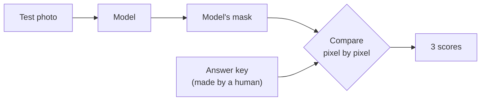
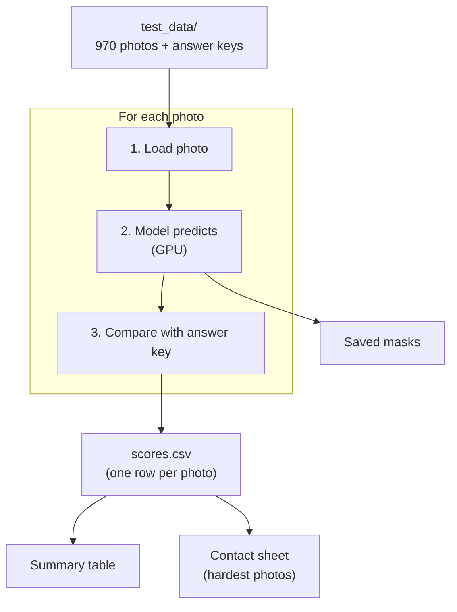

# Step 5: Benchmark: which model is best?

**Goal:** choose the default model from measurements, not assumptions.


## How a model is graded

Each test photo comes with an **answer key**: a mask drawn by a person. The
model's mask is compared with it, pixel by pixel.



| Score | Question it answers | Best |
|---|---|---|
| **MAE** | On average, how wrong is each pixel? | 0 |
| **F-measure** | Right shape? Nothing missing, nothing extra? | 1 |
| **Boundary F** | Are the **edges** in the right place? Only a thin band around the outline is checked; that's where models differ | 1 |

Boundary F matters most here. A test with a hand-made mask shows why: missing
a thin cable barely changes F-measure (still > 0.97) but drops boundary F
clearly.

## The benchmark script

```
bgchange/benchmark/
├── dataset.py   list (photo, answer key) pairs + each object's category
├── metrics.py   the 3 scores (14 tests on hand-made masks)
├── runner.py    load → predict → save mask → score, row by row
└── report.py    summary table + contact sheets, without the GPU
```



Interrupted runs resume where they stopped, and the report can be rebuilt any
time without the GPU.

## The test data

**Rule: test photos must not be training photos.** A model tested on images it
trained on scores well because it memorised them.

| Set | What | Photos | Answer key | Why this set |
|---|---|---|---|---|
| **DIS-VD** | Objects from 200+ categories; about half are product-like (furniture, tools, kitchenware, accessories, electronics) | 470 | Hand-drawn in-or-out masks | BiRefNet's README keeps it out of training |
| **P3M-500-NP** | Portraits, faces not blurred, real hair | 500 | Soft alpha mattes | Kept out of training by BiRefNet's matting model |

I first proposed P3M-500-P and AIM-500, then found in BiRefNet's README that
its general model **trained** on them, so I switched. Details: [`test_data/README.md`](../test_data/README.md).

Only the test split of each dataset is downloaded (757 MB instead of about
12 GB), pinned to an exact commit, verified with SHA-256 and checked against
the official count.

## Results

| Model | Objects (470) | Product-like (248) | People (500) | Per photo | Licence |
|---|---|---|---|---|---|
| inspyrenet | ~~0.984~~ trained on it | ~~0.985~~ trained on it | 0.984 | 0.45 s | MIT |
| rmbg-2.0 | ~~0.944~~ maybe trained on it | ~~0.944~~ | 0.991 | 0.42 s | non-commercial |
| **birefnet** | **0.925** | **0.920** | **0.994** | 0.42 s | MIT |
| ben2 | 0.909 | 0.904 | 0.973 | 0.52 s | MIT |
| birefnet-matting | 0.719 | 0.710 | 0.989 | 0.41 s | MIT |

*Boundary F, higher is better. MAE and F-measure give the same ranking.*

## The key finding: the top scorer had seen the test

InSPyReNet won objects by a wide margin (0.984 vs 0.944). That was suspicious,
so I checked the training data of each model:

| Model | Trained on DIS-VD? | Source |
|---|---|---|
| InSPyReNet | **Very likely yes**: its "Plus_Ultra" checkpoints list DIS-VD among their training data, and the model zoo says those checkpoints were used for `transparent-background` (our weights) | [InSPyReNet model zoo](https://github.com/plemeri/InSPyReNet/blob/main/docs/model_zoo.md) |
| RMBG-2.0 | **Claimed by a competitor**: BEN2's README says "RMBG 2.0 did not preserve the DIS 5k validation dataset". BRIA says it trained on its own 15k images. | [BEN2](https://github.com/PramaLLC/BEN2/) |
| BEN2 | No: validation set preserved | [BEN paper](https://arxiv.org/html/2501.06230v2) |
| BiRefNet (+ matting) | No: DIS-VD is its test set | [BiRefNet](https://github.com/ZhengPeng7/BiRefNet) |

The contact sheet of the hardest photos makes it visible. On **ambiguous**
photos, where "the subject" is an arbitrary choice by the person who labelled
it, only InSPyReNet matches the answer exactly:

| Photo | Answer key | Other models | InSPyReNet |
|---|---|---|---|
| Building with a fire escape | only the fire escape | the whole building | exactly the fire escape (0.96) |
| Org chart on a poster | only the chart boxes | the whole poster | exactly the boxes (1.00) |
| Microphone stand at night | only the stand | parts, or people nearby | exactly the stand (1.00) |

A model can't guess those choices; it gets them right because it saw these
photos and their answers.

## What we can conclude

- **People:** fair for all 5 models (none trained on P3M-500-NP). **BiRefNet is best** (0.994).
- **Objects, among fair models:** **BiRefNet is best** (0.925), ahead of BEN2 (0.909).
- **BiRefNet-matting** is a people specialist: 0.99 on people, 0.72 on objects.
- **InSPyReNet and RMBG-2.0 on products: still unknown.** No public object set is
  clean for InSPyReNet: its training also covers DUTS, ECSSD, HKU-IS and others.

## Licence note

RMBG-2.0 is CC BY-NC 4.0: free for research and testing, **not for commercial
use** without a paid licence from BRIA. It stays available as an option but
will not be the default in this repo.

## Next: a fair product test

| Option | How | Numbers? | Effort |
|---|---|---|---|
| **A** (first) | Find a product/object dataset published **after** the models (InSPyReNet: Jan 2024, RMBG-2.0: late 2024) | ✅ | small |
| **D** (fallback) | Draw answer keys for ~10 product photos ourselves + eye-test ~25 more | ✅ | medium |

## Run it

```bash
uv run python scripts/run_benchmark.py --model all
```

```bash
uv run python scripts/run_benchmark.py --report-only
```

```bash
uv run python scripts/plot_benchmark.py
```

Results land in `benchmarks/results/` (not in git): `summary.md`, contact sheets
and every predicted mask.

## Result

Commits `b1db92c`, `f596538`. 68 tests.
