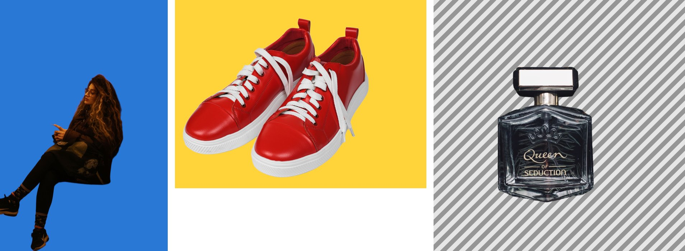
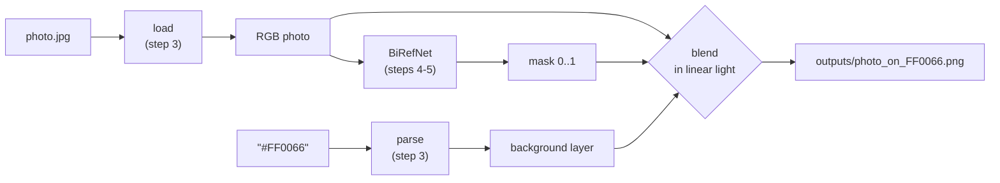
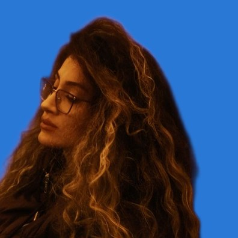

# Step 6a: Compositing: the subject on the new colour

**Goal:** turn photo + mask + hex colour into the final image. This is the
core of the task.



*Left to right: `#2A78D6`, `#FFD43B`, `#00000000` (transparent, shown on stripes).*

## How it works



For every pixel:

```
out = photo × mask + colour × (1 − mask)

mask = 1    → the photo's pixel, unchanged
mask = 0    → the new colour
mask = 0.3  → 30% photo + 70% colour   (soft edge, hair)
```

## The code

```
bgchange/s5_new_background/
├── linear_light.py   sRGB ↔ linear light
├── background.py     a plain layer of the chosen colour
├── blend.py          composite(): the formula above
└── save.py           outputs/<photo>_on_<HEX>.png, always PNG
scripts/change_background.py   the command that runs all the steps
```

## Decisions

| Question | Choice | Why |
|---|---|---|
| Where to mix | **Linear light**, not raw pixel values | See below |
| Output size | Same as the original | Never lose quality |
| Output format | **PNG** always | Lossless: JPEG compression would blur the soft edges. Can hold transparency |
| Colour with alpha (`#FF006680`) | RGBA PNG, background half-transparent | The hex parser accepts alpha, so it must mean something |
| `#00000000` | A plain cut-out: the output's transparency **is** the mask | Useful for free, same code |
| Bad colour | Checked **before** loading the model | A typo fails at once, not after 10 s |

### Why linear light

Pixel values are not amounts of light. sRGB value 128 looks "half grey" but
carries only **21.6%** of white's light (the sRGB standard's curve).

An edge pixel that is half subject and half background receives half of the
light of each. So the mix must be done on light:

| Half black + half white | Result | Looks like |
|---|---|---|
| Mixing pixel values | 128 | too dark: grey outline around soft edges |
| **Mixing light (ours)** | **188** | what a camera would see |

`tests/s5_new_background/test_blend.py` checks exactly this case.

### Transparent colours: the "over" operator

When the background is partly transparent, it only covers part of each pixel:

```
out_alpha = mask + bg_alpha × (1 − mask)
out_rgb   = (photo × mask + bg × bg_alpha × (1 − mask)) / out_alpha
```

With a solid colour (`bg_alpha = 1`) this is the first formula again.

## What it does not do yet



Edge pixels in the photo already contain some of the **old** background.
Where the mask is 0.5, half of that pixel's colour is old background, and it
shows as a faint dark halo around the hair. Fixing it needs a guess of the
subject's true colour at the edges: that is **step 6b**, see
[06b-edge-cleanup.md](06b-edge-cleanup.md).

The product has no shadow either, so it looks like it floats: **step 6c**.

## Speed (RTX 5050, 1600 × 2400 photo)

| Part | Time |
|---|---|
| Load the model | ~11 s (once; much longer on a cold disk) |
| Mask | ~0.4–0.9 s |
| Blend + save | ~0.7 s |

The API (step 8) will load the model once and keep it in memory.

## Run it

```bash
uv run python scripts/change_background.py photo.jpg --color "#FF0066"
```

```bash
uv run python scripts/change_background.py photo.jpg --color "#00000000"
```

Result: `outputs/photo_on_FF0066.png`.

## Result

16 new tests (84 in total).
