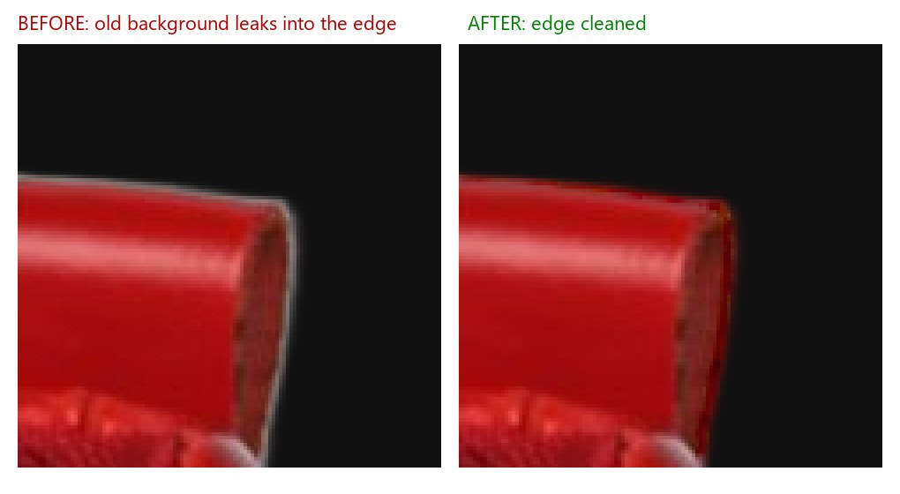
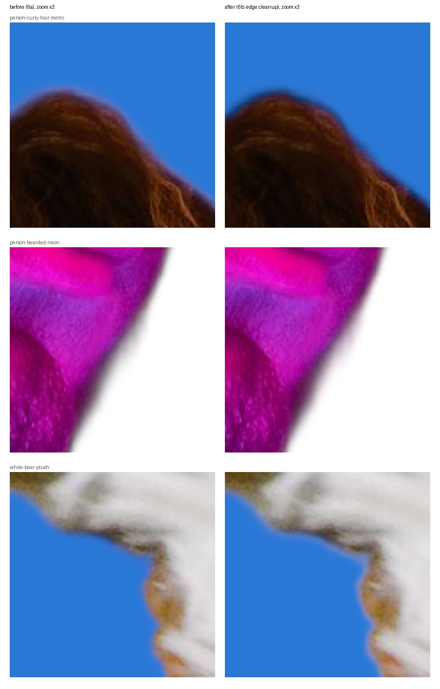
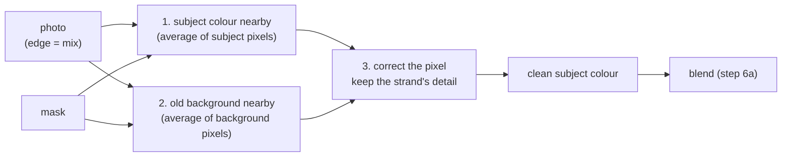
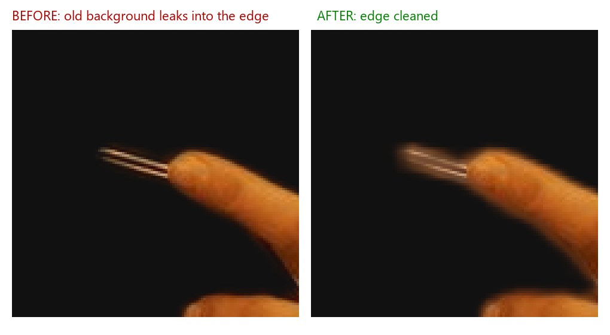

# Step 6b: Edge cleanup: remove the old background from the edges

**Goal:** no halo of the old background around hair, fur and soft edges.



*Red sneakers shot on **white**, put on **black**, zoomed 8x on the heel. Before:
a light line, the leftover of the white wall. After: gone.*

The effect is strongest when the old and the new background are very
different (white studio → black). When they are similar (a dark street → a
dark colour), there is little to clean and little difference to see.



*Zoomed 3x on the spot where cleanup changed the image most (found
automatically, not hand-picked). Hair: the light grey rim is gone. Neon portrait:
the grey fringe becomes the skin's own colour. Plush: the brownish outline
becomes white fur.*

## The problem

An edge pixel was already a mix when the camera took the photo:

```
photo = subject × mask + old background × (1 − mask)
```

The model gives the mask (**how much** is subject), not the subject's own
colour. In step 6a that pixel was mixed with the new colour as it was, so a bit
of the old background stayed in it.

## The fix: guess the subject's own colour



1. **Subject colour nearby:** average the pixels around it, each one counting
   as much as its mask says it is subject.
2. **Old background nearby:** the same, with the background pixels.
3. **Correct the pixel:** start from 1, and add back what the photo shows that
   1 and 2 don't explain. That last part keeps the detail of each hair strand.

This is done twice: a **90 px** window for a rough guess, then a **6 px** one
for detail. The method is "blur fusion" ([Forte & Pitié, 2021](https://arxiv.org/abs/2006.14970)).
Pixels with mask = 1 come out unchanged.

## The code

```
bgchange/s5_new_background/
├── foreground.py   estimate_foreground(): steps 1-3 above      (new)
└── blend.py        composite(..., clean_edges=True) uses it    (changed)
```

## Decisions

| Question | Choice | Why |
|---|---|---|
| Method | Blur fusion, written here (about 20 lines) | No new library: OpenCV's box blur was already installed. Fast. Easy to explain |
| Not chosen | The `pymatting` library | A new dependency (with numba) for the same result, slower |
| Window sizes | 90 px, then 6 px, as in the paper | Our photos are about 1600 px, close to the paper's |
| Colour space | Linear light, like the blend | The camera mixes light, so the formula holds on light |
| Default | **On** | Off only to compare: `--no-edge-cleanup` |

## Known side effect: a glow where the mask is unsure



The cleanup trusts the mask. Where the AI is unsure and the mask is blurry over
a wide area (here a thin object next to a finger), the cleanup fills that
blurry area with the subject's colour, which shows as a soft glow. It showed
up in 1 of the 4 photos zoomed into; the halo fix helped in all 4, so cleanup
stays **on**, and `--no-edge-cleanup` turns it off for such a photo. A possible later fix: clean only where the mask is a thin edge.

## Tests

`tests/s5_new_background/test_foreground.py` builds a made-up red-on-green
edge, half-and-half in the middle, the way a camera would. After cleanup, the
middle column must be red again (within 2%), and the red subject must stay
exactly as it was.

## Speed (1600 × 2400 photo)

| | Blend + save |
|---|---|
| Without cleanup (6a) | ~0.5 s |
| With cleanup (6b) | ~1.4 s |

## Run it

```bash
uv run python scripts/change_background.py photo.jpg --color "#FF0066"
```

```bash
uv run python scripts/change_background.py photo.jpg --color "#FF0066" --no-edge-cleanup
```

The second one saves `outputs/photo_on_FF0066_no-cleanup.png`, so both versions
sit side by side.

## Result

4 new tests (88 in total).
