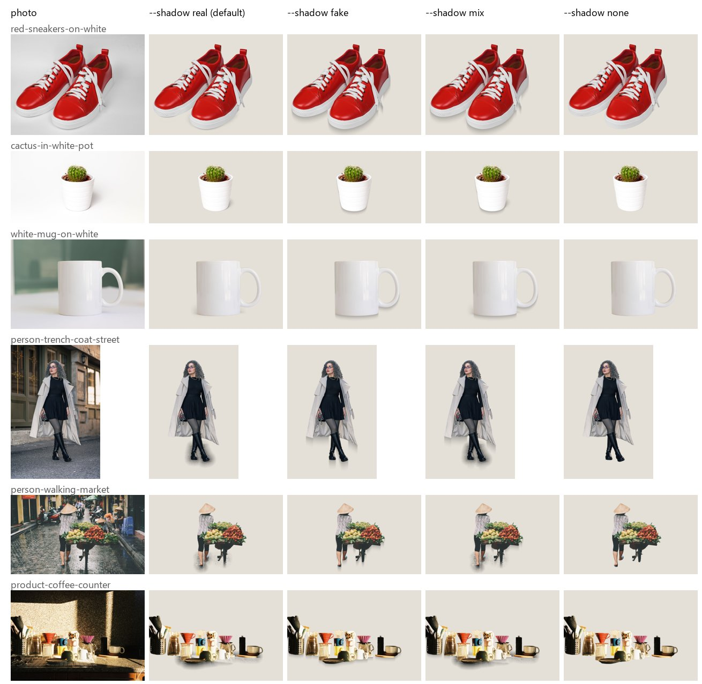
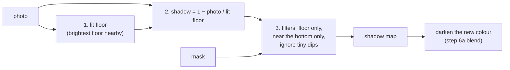
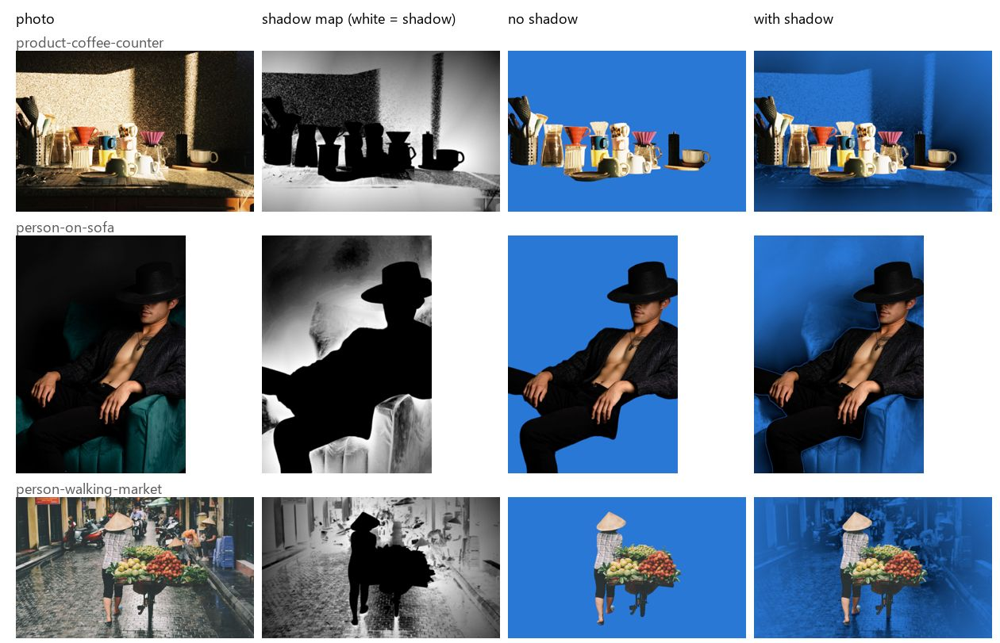

# Step 6c: Shadows: real, fake, both or none

**Goal:** the subject should stand on the new colour, not float. The brief asks
for "a parameter to keep shadows".



*Columns: photo, then `--shadow real` (default), `fake`, `mix`, `none`, on `#E4E0D8`.*

## The 4 choices

| `--shadow` | What it is | Best for |
|---|---|---|
| **`real`** (default) | The photo's own shadow, measured near the bottom of the subject | Studio product photos: soft and natural |
| `fake` | A soft shadow computed from the subject's outline, straight down | Photos with no usable shadow; clean on any background, but looks more "added" |
| `mix` | Both: at each pixel, the darker of the two | The most "grounded" look |
| `none` | No shadow | When a shadow looks wrong |

`--shadow-strength` (0 to 1, default 1) makes any of them lighter.

## How the real shadow is measured



1. **Lit floor:** for every spot, how bright the floor would be without a
   shadow. A shadow is always darker than the lit floor around it, so this is
   the brightest floor nearby (a max filter over a quarter of the photo, done on a
   256 px copy for speed).
2. **Shadow:** `1 − photo / lit floor`. 40% less light → 0.4.
3. **Filters:** not on the subject; only within 5% of the photo size from the
   **lowest 15% of the subject** (feet, the base of a product), where a shadow
   touches the floor; below 5% darkness is texture or noise.

Only the **darkness** moves to the new colour, never the old floor's colour or
texture: the new colour is covered by black as opaque as the shadow is dark.
With a transparent colour (`#00000000`), the shadow becomes semi-transparent
black in the PNG.

## Why "near the bottom only"



The first version searched up to 50% of the photo around the subject. On studio
photos it worked, but on busy ones (a street, a café counter, a sofa) every dark
area of the old scene counted as shadow, leaving a **ghost of the old scene** on
the new colour (above: shadow map in column 2, result in column 4).

Looking only around the **bottom** of the subject, where its shadow touches the
floor, removed the ghosts. On busy photos a few small smudges of floor texture
can remain near the feet; `--shadow fake` or `none` are clean there.

## How the fake shadow is made

Computed from the mask, no image is pasted. For every column of pixels: find
the subject's lowest pixel, draw shadow from there downwards (2 px inside the
subject, so there is never a gap), darkest at the touch point, fading over 10%
of the subject's height, then blur. The first version flattened the whole
outline under the subject and could leave a gap; this one always touches.

## The code

```
bgchange/s4_shadow/
├── lit_background.py   find_lit_background(): the floor without shadows
├── shadow_map.py       extract_shadow(): the real shadow, near the bottom
├── fake_shadow.py      make_fake_shadow(): computed from the mask
└── choose.py           make_shadow(kind, ...): real / fake / mix / none × strength
bgchange/s5_new_background/
├── background.py       the colour layer, darkened by the shadow     (changed)
└── blend.py            composite(..., shadow=...)                   (changed)
```

## Decisions

| Question | Choice | Why |
|---|---|---|
| Default | `real` | The photo's own shadow is the most natural on product photos |
| Choice for the user | `--shadow real|fake|mix|none` | No single method is best on every photo |
| Where to look | Lowest 15% of the subject, 5% of the photo around it | 50% gave ghosts on busy photos |
| Strength | `--shadow-strength`, default 1 | An exact shadow can look too strong on some colours |
| Colour space | Linear light | A shadow is less light, so it is measured on light |

## Perspectives: AI shadow models (not done)

I searched for AI models that generate shadows. None fits now:

| Model | Why not now |
|---|---|
| SGDiffusion (CVPR 2024), GPSDiffusion (CVPR 2025) | Real AI shadows, SGDiffusion is Apache-2.0. But built on Stable Diffusion (several GB, hours to download on this connection) and trained on objects in real scenes, not on plain colours. Worth testing later |
| SSN, PixHt-Lab (Adobe research) | Made for exactly this (soft shadow from a cut-out), but non-commercial licence |
| Controllable shadow generation, single step (Jasper Research, 2024) | Best fit on paper (object on plain background, controllable light); public weights not confirmed |
| Shadow-removal models (ShadowFormer…), used in reverse | shadow = photo ÷ shadow-free photo would remove the texture smudges of `real`; licences to check |

Sources: [Awesome Object Shadow Generation](https://github.com/bcmi/Awesome-Object-Shadow-Generation),
[SGDiffusion](https://github.com/bcmi/Object-Shadow-Generation-Dataset-DESOBAv2),
[GPSDiffusion](https://github.com/bcmi/GPSDiffusion-Object-Shadow-Generation),
[SSN](https://github.com/ShengCN/SSN_SoftShadowNet),
[PixHt-Lab](https://github.com/ShengCN/PixHtLab-Src),
[arXiv 2412.11972](https://arxiv.org/abs/2412.11972),
[ShadowFormer](https://github.com/GuoLanqing/ShadowFormer).

## Speed (1600 px photos)

| `--shadow` | Time |
|---|---|
| real | 0.1–0.3 s |
| fake | < 0.1 s |
| mix | 0.15–0.4 s |

## Run it

```bash
uv run python scripts/change_background.py photo.jpg --color "#FF0066"
```

```bash
uv run python scripts/change_background.py photo.jpg --color "#FF0066" --shadow mix --shadow-strength 0.7
```

A choice other than `real` adds it to the file name, e.g.
`outputs/photo_on_FF0066_shadow-mix.png`, so versions sit side by side.

## Result

16 new tests (104 in total).
