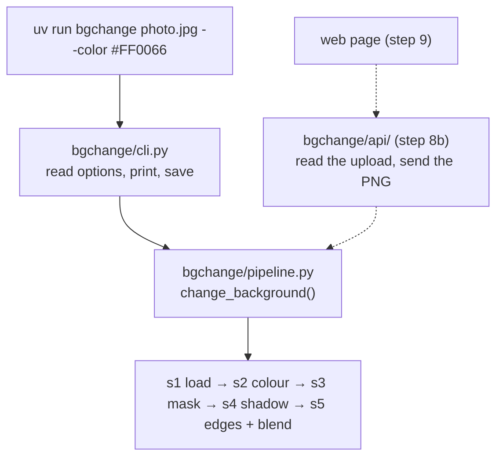

# Step 8a: The `bgchange` command and one shared pipeline

**Goal:** the CLI the brief asks for, as a real command, and one function that
the CLI and the (optional) API both call, so they can never give different
results.

```bash
uv run bgchange photo.jpg --color "#FF0066"
```

## How it is built



| File | Job |
|---|---|
| `bgchange/pipeline.py` | `change_background(photo, colour, shadow=..., ...)` runs the 5 steps and returns a `Result`: the image, the colour, the loader's notes, the time of each part. It does not save or print |
| `bgchange/cli.py` | `main()`: reads the options, calls `change_background()`, saves the PNG, prints a short report |
| `pyproject.toml` | `[project.scripts] bgchange = "bgchange.cli:main"` turns `main()` into the `bgchange` command |
| `scripts/change_background.py` | Now 2 lines that call `main()`, so the older command still works |

## Decisions

| Question | Choice | Why |
|---|---|---|
| Where the logic lives | One function, `change_background()` | CLI and API stay identical; a fix in one place fixes both |
| What it accepts | A path **or** raw bytes | The CLI has a file, the API has an upload |
| Saving and printing | Left to the caller | The CLI writes a file; the API sends bytes back |
| Order of checks | Colour and options first, then the photo, then the model | A typo fails at once instead of after 10 s of model loading |
| Expected errors (bad colour, missing file, model not downloaded) | One clear line, no Python traceback | It is a tool for people, not for debugging |
| Default file name | `outputs/<photo>_on_<HEX>.png`, plus `_shadow-mix` etc. for non-default options | Versions made to compare sit side by side |

## Example

```
$ uv run bgchange cactus-in-white-pot.jpg --color "#2A78D6"
image  : cactus-in-white-pot.jpg (1600x864)
colour : #2A78D6
model  : birefnet, loaded in 9.9s, mask in 1.80s
shadow : real, strength 1, 0.18s
blend  : 0.70s
saved  : outputs\cactus-in-white-pot_on_2A78D6.png
```

## Tests

`tests/test_pipeline_and_cli.py` (11 tests) replaces the AI model with a fake
one that returns a square, so they run in a second without a GPU. They check:
the result's size and colour, bytes accepted like an upload, a bad colour fails
**before** the model is loaded, wrong shadow options are refused, `-o` and the
default file names, and errors are one clear line.

## Result

11 new tests (115 in total).
