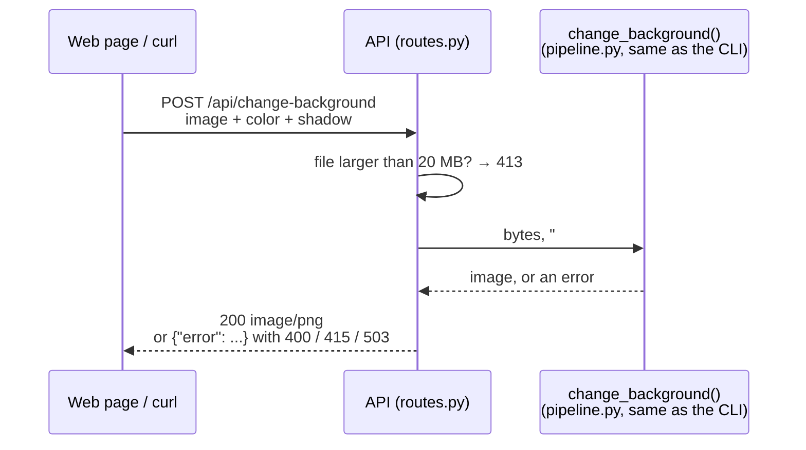

# Step 8b: The web API (optional)

**Goal:** let a web page (step 9) use the tool. The CLI stays the main way to
use the project; the API is an extra layer on top of the **same**
`change_background()` function, so both give identical results.

```bash
uv run bgchange-api
```

Then open <http://127.0.0.1:8000/docs>: an interactive page, generated by
FastAPI, where every route can be tried in the browser.

## The 2 routes

| Route | What it does |
|---|---|
| `GET /api/health` | Is the server up, and is the model loaded? |
| `POST /api/change-background` | Photo + colour (+ shadow options) → the PNG |

### `GET /api/health`

```json
{ "status": "ok", "model": "birefnet", "model_loaded": true, "device": "cuda" }
```

`model_loaded: false` means the server started but the model is not downloaded
(the server does not crash; `change-background` then answers 503).

### `POST /api/change-background`

A form with a file (`multipart/form-data`), like any web upload:

| Field | Required | Values | Default |
|---|---|---|---|
| `image` | yes | the photo: JPEG, PNG, WebP, ... up to 20 MB | |
| `color` | yes | `#RGB`, `#RRGGBB`, `#RRGGBBAA`, e.g. `#FF0066` | |
| `shadow` | no | `real`, `fake`, `mix`, `none` | `real` |
| `shadow_strength` | no | 0 to 1 | 1 |

The answer is the **PNG itself** (`Content-Type: image/png`), with these headers:

| Header | Example |
|---|---|
| `Content-Disposition` | `inline; filename="shoe_on_FF0066.png"` |
| `X-Processing-Time-Ms` | `2940` |
| `X-Image-Size` | `1600x1200` |
| `X-Model` | `birefnet` |

### Errors: always `{"error": "a sentence for people"}`

| Code | When | Example message |
|---|---|---|
| 400 | bad colour, bad option, missing field | `"blue" is not a hex colour: ...` |
| 413 | file larger than the limit | `The file is larger than 20 MB.` |
| 415 | not a readable image | `This file is not a readable image. Supported: JPEG, PNG, ...` |
| 503 | model not downloaded on the server | `Model 'birefnet' is not downloaded ...` |

## What happens on a request



## How it is built

```
bgchange/api/
├── settings.py   options from environment variables (for Docker)
├── routes.py     the 2 routes, the error codes, the PNG answer
├── app.py        create_app(): loads the model once at start-up, CORS, error shape
└── server.py     the `bgchange-api` command
```

| Setting (environment variable) | Default | What |
|---|---|---|
| `BGCHANGE_MODEL` | `birefnet` | AI model |
| `BGCHANGE_DEVICE` | `auto` | `auto`, `cuda` or `cpu` |
| `BGCHANGE_MAX_UPLOAD_MB` | `20` | upload limit |
| `BGCHANGE_CORS_ORIGINS` | `http://localhost:3000` | web pages allowed to call the API |
| `BGCHANGE_PRELOAD` | `1` | load the model at start-up |

## Decisions

| Question | Choice | Why |
|---|---|---|
| Which routes | Only 2 | That is all the web page needs; `/docs` comes free with FastAPI |
| Upload format | Form with a file | What every browser and `curl` send natively; no base64, no 33% size overhead |
| Answer format | The PNG bytes, info in headers | The page shows it directly; no base64 inside JSON |
| Model loading | Once, at start-up | ~10 s once instead of on every request; then ~1-3 s per photo |
| Missing model | Server starts anyway, `/api/health` says so | Easier to diagnose than a crash |
| Many requests at once | One photo at a time on the GPU (a lock), in a worker thread | Two at once could run out of GPU memory and would not be faster; `/api/health` still answers meanwhile |
| Big uploads | Read at most limit + 1 byte | Refuses a huge file without loading it into memory |
| Errors | One shape, `{"error": ...}`; FastAPI's 422 becomes 400 with one sentence | One thing for the web page to read and show |
| Cross-origin calls (CORS) | Only the listed web pages | A browser blocks calls from `localhost:3000` to `localhost:8000` unless the API allows that page |

## Try it

Start the server (keep this terminal open):

```bash
uv run bgchange-api
```

In a second terminal. On Windows PowerShell, write **`curl.exe`**, because
`curl` alone is another command there:

```bash
curl.exe http://127.0.0.1:8000/api/health
```

```bash
curl.exe -F "image=@photo.jpg" -F "color=#FF0066" -F "shadow=mix" -o result.png http://127.0.0.1:8000/api/change-background
```

Or open <http://127.0.0.1:8000/docs>, click the route, "Try it out", choose a
photo, "Execute".

## Measured (RTX 5050, 1600 × 1200 photo)

| | Time |
|---|---|
| Server start (model loading) | ~10 s, once |
| First request (GPU warm-up) | 5.3 s |
| Next requests | 2.9 s |

## Tests

`tests/api/test_api.py` (18 tests) sends real HTTP requests to the app in
memory, with a fake AI model: health, the PNG and its headers, every shadow
choice, transparent colours, each error code and its message, the upload limit,
CORS, and that `/docs` exists.

## Result

18 new tests (133 in total).
