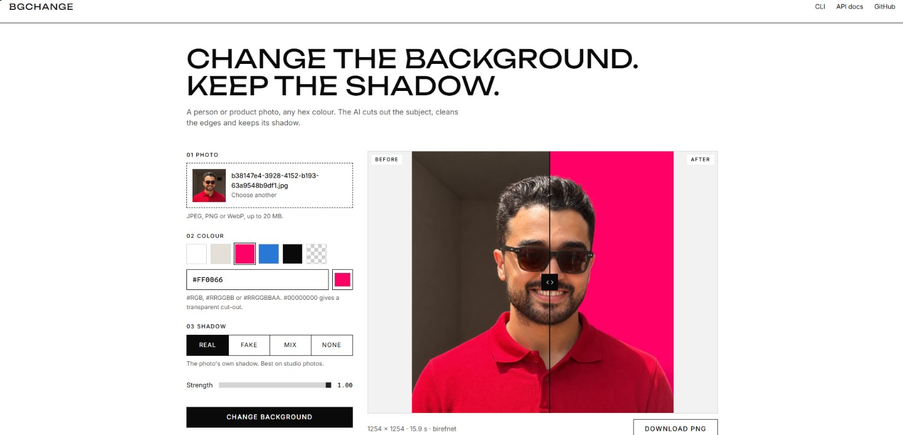
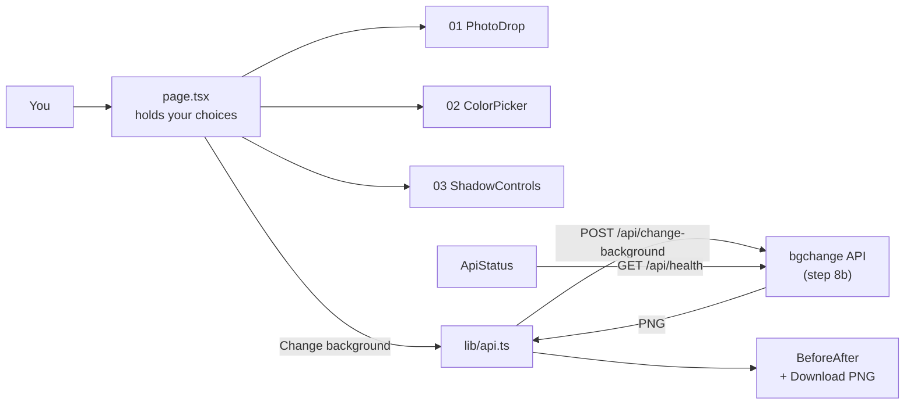
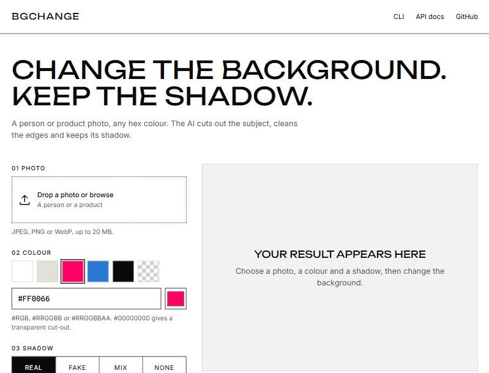

# Step 9: The web page (optional)

**Goal:** an easier way to use the tool, for people who don't use a terminal.
It is an extra: the CLI (`uv run bgchange ...`) stays the main way, and the
page's footer shows the matching command for the current settings.



*A portrait on `#FF0066` with the `real` shadow, 15.9 s on the CPU (the Docker
version). Drag the black handle to compare before and after.*

## How to run it

Two terminals, both in the project folder:

```bash
uv run bgchange-api
```

```bash
cd frontend
npm install
npm run dev
```

Then open <http://localhost:3000>. (`npm install` only the first time: it
downloads Next.js and React, about 380 MB.)

## How it works



The page never processes images itself: it sends the photo to the API, which
calls the same `change_background()` as the CLI. So the page, the API and the
CLI always give the same result.

## The files

```
frontend/
├── app/layout.tsx              fonts (Unbounded, Inter) and the page title
├── app/page.tsx                the page: your choices, the button, the result
├── app/globals.css             all the styles, with the colour and size tokens at the top
├── components/
│   ├── PhotoDrop.tsx           01: drop or browse a photo (checks type and 20 MB)
│   ├── ColorPicker.tsx         02: swatches, hex box, the browser's colour picker
│   ├── ShadowControls.tsx      03: real / fake / mix / none + strength
│   ├── BeforeAfter.tsx         the comparison slider
│   └── ApiStatus.tsx           a banner with the fix when the API isn't usable
└── lib/api.ts                  the 2 calls to the API, in one place
```

## Design: in the spirit of modelia.ai

| | Choice |
|---|---|
| Colours | Black `#0A0A0A` and white; grey `#555` for secondary text (7.5:1 contrast); no accent colour, so the photo and the chosen colour stand out |
| Headings | **Unbounded**, uppercase: a free, wide font close to Modelia's *Monument Extended* (a paid font) |
| Text | **Inter**, which Modelia also uses |
| Shapes | Square corners, thin black lines, black buttons with white text |

Not copied: Modelia's logo, name and images. The page is called **bgchange**.

I ran the ui-ux-pro-max design generator: its layout rules and quality
checklist were followed, but its suggested pink + gold palette and serif font
did not match Modelia, so they were not used. Its font search found no wide
sans-serif; Unbounded is my own choice.

## The page's states

| State | What you see |
|---|---|
| Empty | "Your result appears here" and what to do |
| Photo chosen | The photo in the result area, a thumbnail in 01 |
| Working (~2-3 s) | "Working…" on the button, a progress bar, the area marked busy for screen readers |
| Result | Before/after slider, size · time · model, **Download PNG** (file named like the CLI's: `shoe_on_FF0066.png`) |
| Transparent colour | The result on a checkerboard, so the cut-out is visible |
| Bad colour | A message under the hex box and under the button; nothing is sent |
| API error | The API's own sentence under the button |
| API not running | A black banner with the exact command, and "check again" |
| Model not downloaded | A banner with the download command |

## Decisions

| Question | Choice | Why |
|---|---|---|
| Framework | Next.js + TypeScript, plain CSS | No UI library or Tailwind: fewer downloads, and the design is simple |
| Where images are processed | Only in the API | One place for the logic: same results as the CLI |
| API address | `NEXT_PUBLIC_API_URL`, default `http://127.0.0.1:8000` | Docker (step 10) can point it elsewhere |
| Fonts | `next/font` | Downloaded at build time and served by the page itself: visitors' browsers never contact Google |
| Shadow choice | Real radio buttons drawn as one bar | Arrow keys work, screen readers announce "1 of 4" |
| Comparison slider | An invisible range input over the image | Mouse, finger and keyboard all work, with no extra library |
| Output | `output: "standalone"` | A small self-contained server for the Docker image |
| AI-assistant file | `AGENTS.md`, created by `next dev`, kept out of git | Not part of the project |

## Checked

- Every state above, in the browser, with the real API on the GPU (result in 1.6 to 1.7 s).
- Keyboard: the comparison slider takes focus and moves with the arrow keys; focus outlines are visible.
- Phone width (375 px): one column, nothing wider than the screen, every button and swatch at least 44 × 44 px.
- `npm run build`: compiles, the strict TypeScript check passes.
- Reduced motion: the progress bar stops moving when the system asks for less motion.


