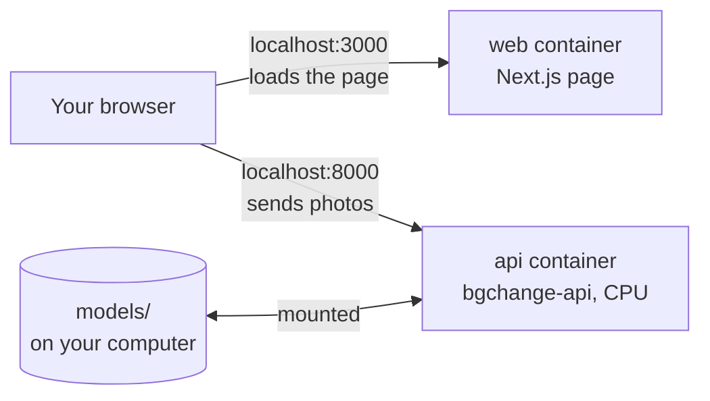

# Step 10: Docker (optional)

**Goal:** one command that starts the web interface on any computer, without
installing Python, uv or Node. The CLI still works without Docker (and inside
it too).

```bash
docker compose up --build
```

Then open <http://localhost:3000>. Stop with **Ctrl + C**.

## What runs



| Container | Image | Port | What it is |
|---|---|---|---|
| `api` | `bgchange-api`, from `Dockerfile` | 8000 | Python 3.12 + the project; runs `bgchange-api` (the same API as step 8b) |
| `web` | `bgchange-web`, from `frontend/Dockerfile` | 3000 | The page of step 9, built and served by Next.js's small standalone server |

`web` waits until `api` is **healthy** (it answers `/api/health` with the model loaded).

## The CLI in Docker

The same image contains the `bgchange` command. Mount the folder with your
photo at `/work`:

```bash
docker compose run --rm -v "${PWD}:/work" api bgchange /work/photo.jpg --color "#FF0066" -o /work/photo_out.png
```

## The model weights

They are **not** in the image (425 MB for BiRefNet; images stay small). The
project's `models/` folder is mounted into the container:

| Computer | What happens on the first `docker compose up` |
|---|---|
| Already has `models/birefnet/` (after `scripts/download_models.py`) | Nothing is downloaded: the container reads the existing files |
| Doesn't have it (a fresh clone) | The container downloads BiRefNet once, into that same `models/` folder (`docker/api-entrypoint.sh`) |

## What is downloaded, and when

Only on the **first** build: the base images, PyTorch for CPU and the other
Python packages, and Next.js. Docker keeps them; the next `docker compose up`
downloads nothing. Changing our code only rebuilds the small last layer of each
image (the Dockerfiles go from "changes rarely" to "changes often").

## Decisions

| Question | Choice | Why |
|---|---|---|
| GPU or CPU | **CPU only** | Works on every computer. The GPU is used when running without Docker (`uv run ...`) on a machine with an NVIDIA card |
| PyTorch | The **CPU** build, same version as `uv.lock` | `pyproject.toml` takes the CUDA build for the development laptop; in a CPU container its ~3 GB of NVIDIA libraries would be useless |
| Other Python packages | Exactly the versions in `uv.lock` (`uv export`) | Same versions as tested |
| Weights | Mounted folder, downloaded only if missing | Small images; nothing downloaded twice |
| Page → API address | `http://localhost:8000`, written into the page at build time | The visitor's **browser** calls the API, not the web container |
| Users | Both containers run as a normal user, not root | Standard safety |
| Build context | `.dockerignore` lists only what is needed | Fast builds: models, test photos, `node_modules` stay out |
| Line endings | `.gitattributes`: `*.sh` always Linux style | A script checked out on Windows would otherwise fail inside Linux |

## Measured

On the development laptop (Docker Desktop, 24 CPU threads, 8 GB for containers):

| | Time |
|---|---|
| First build (one-time downloads) | a few minutes |
| `docker compose up` until the API is healthy | ~1 minute (model already in `models/`) |
| One photo through the page or the API (CPU) | **18-20 s** (640 × 480 to 1600 × 864) |
| One photo with the CLI in Docker (`mask` part) | 17.8 s |
| For comparison: the same photo on the laptop's GPU, without Docker | ~2.6 s |

Images: `bgchange-api` 2.17 GB (mostly PyTorch for CPU), `bgchange-web` 306 MB.

The time depends little on the photo's size: BiRefNet always works on a
1024 × 1024 copy, and only the blend runs at full size.

## Troubleshooting

| Problem | Fix |
|---|---|
| `port is already allocated` | Something already uses 8000 or 3000, e.g. `uv run bgchange-api` or `npm run dev` from steps 8b/9. Stop it with Ctrl + C |
| Still `port is already allocated` after Ctrl + C (Windows) | Ctrl + C can stop the command but leave its server running. Task Manager → Details → end `python.exe` (bgchange-api) or `node.exe` (next) |
| The page says "The API isn't running" | The API is still loading or downloading the model; wait, then "check again" |
| `Cannot connect to the Docker daemon` | Start Docker Desktop |
