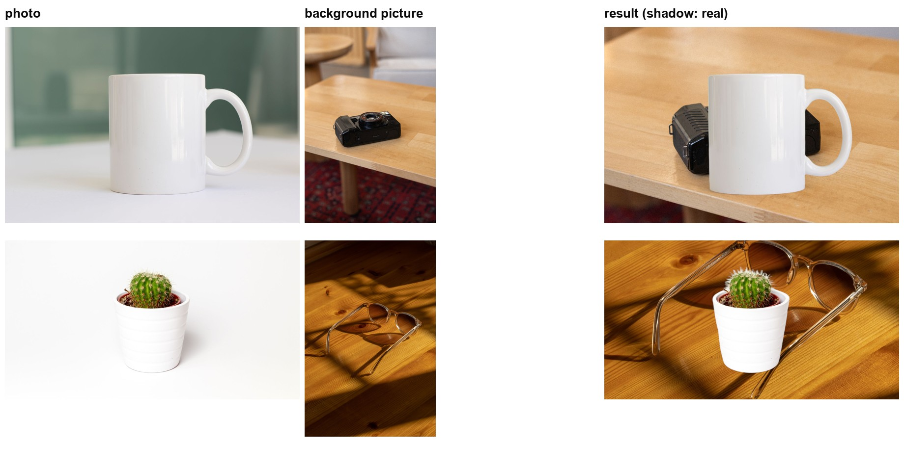
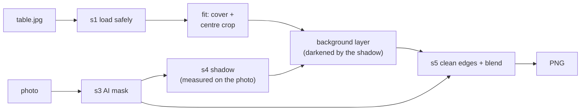

# Step 11: A picture as the background

**Goal:** besides a hex colour, put the subject on a **picture** (a table, a
wall, a scene). It is an extra on top of the brief, which asks for a colour:
the colour stays the main feature.

```bash
uv run bgchange mug.jpg --background table.jpg
```



*Top: a studio mug on a wooden table, it looks natural. Bottom: the cactus,
lit evenly in a studio, on wood in strong sunlight: the light doesn't match,
so it looks pasted (see Limits).*

## How it works

Only the background layer changes. The AI mask, the edge cleanup, the shadow
and the blend are exactly the same as with a colour.



1. **Load** the picture with the same safe loader as the photo: phone rotation,
   CMYK, 16-bit, colour profiles, the 50 megapixel limit.
2. **Fit** it to the photo's size: scaled to *cover* the whole photo (no empty
   bands), never stretched, then the overflow is cut equally on both sides.
3. **Shadow:** measured on the original photo, as before, then applied to the
   picture as darkness: each pixel of the picture gets the same amount less
   light, so the wood grain stays visible inside the shadow.
4. **Blend**, in linear light: `out = photo × mask + picture × (1 − mask)`.

### Fit: cover, then centre crop

```
photo 1600 x 1067 (3:2), table picture 1600 x 2400 (2:3)

  1. scale so both sides are at least the photo's:  x 1.0  -> 1600 x 2400
  2. keep the middle 1600 x 1067, cut the rest above and below

        +----------+
        |##########|
        |----------|
        |  kept    |   # = cut off
        |----------|
        |##########|
        +----------+
```

## The code

```
bgchange/s5_new_background/
├── background_image.py   fit_background(): scale to cover + centre crop      (new)
├── background.py         make_background(): a colour OR a picture           (changed)
├── blend.py              composite(photo, mask, background, ...)            (changed)
└── save.py               outputs/<photo>_on_<picture name>.png              (changed)
bgchange/pipeline.py      change_background(..., background_image=...)        (changed)
bgchange/cli.py           --background, instead of --color                     (changed)
bgchange/api/routes.py    a `background` file field, instead of `color`       (changed)
frontend/components/
├── ImageDrop.tsx         the drop box, shared by 01 Photo and 02 Background  (new)
└── BackgroundPicker.tsx  02 Background: COLOUR / IMAGE                       (new)
```

## Use it

| Where | How |
|---|---|
| CLI | `uv run bgchange mug.jpg --background table.jpg` (all the other options work the same) |
| API | `POST /api/change-background` with a file field `background` instead of `color` |
| Web page | 02 Background → **Image**, then drop the picture |

Exactly one background is required: a colour **or** a picture. Giving both
(or neither) is a clear error in the CLI, the API (400) and the page.

## Decisions

| Question | Choice | Why |
|---|---|---|
| Fit | Cover + centre crop | Never stretched, never empty bands; the middle of a picture is usually its subject |
| Loading | The photo's own loader | The same safety for a file we didn't take: rotation, CMYK, size limit |
| Transparency in the picture | Ignored | A background is opaque; a PNG background with holes would make an unclear result |
| Shadow | Unchanged: measured on the photo, applied as darkness | The amount of light blocked doesn't depend on what is behind |
| Checked before the model | Yes, like the colour | A broken background file fails at once, not after 10 s of model loading |
| Output name | `<photo>_on_<picture>.png` | Versions sit side by side, like colours |

## Limits

- **Light and perspective:** the subject keeps its own lighting. A studio photo
  on a sunny, angled scene looks pasted. Best: a simple background (a wall, a
  table, a floor) lit like the photo. Matching the light would be a next step.
- **Scale and position:** the subject stays where it is in the photo, at its
  size; the picture is not moved or zoomed to fit it.
- **Real shadow:** it comes from the old floor, so on a background with a very
  different floor angle `--shadow fake` or `none` can look better.

## Tests

18 new tests (151 in total): the fit (size, crop, no stretch, enlarging), the
blend with a picture (mask 0 and 1, shadow on a picture), the pipeline and the
CLI (default name, one background only, a broken picture fails before the
model), and the API (the PNG, 400, 413, 415).
