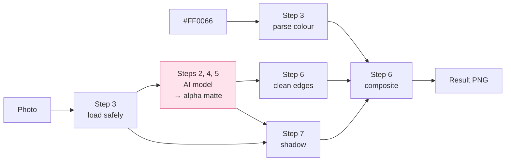
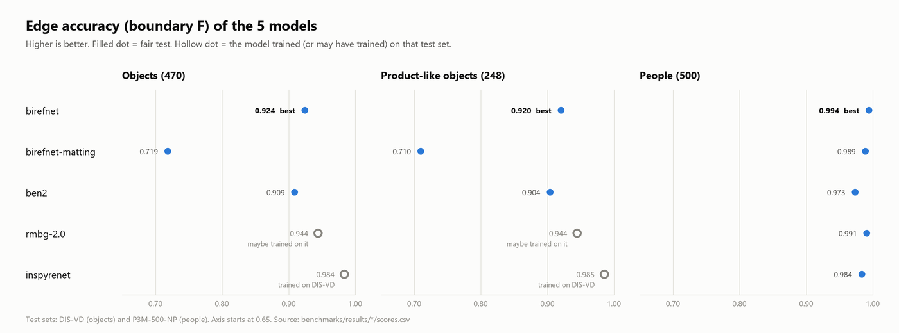

# Project documentation

One document per step of the project, in the order the work was done. Each
one says **what was built, how it works (with a diagram), which decisions
were made and why, and what went wrong**.

| Step | Document | Status |
|---|---|---|
| 1 | [Repo baseline](01-repo-baseline.md) | ✅ |
| 2 | [GPU and the first model](02-gpu-and-first-model.md) | ✅ |
| 3 | [Input handling and hex colour parsing](03-input-handling.md) | ✅ |
| 4 | [The 5 segmentation models and the registry](04-segmentation-models.md) | ✅ |
| 5 | [Benchmark: which model is best?](05-benchmark.md) | ✅ BiRefNet chosen |
| 6 | Edge cleanup and compositing | ⬜ |
| 7 | Shadow extraction | ⬜ |
| 8–10 | API, web interface, Docker | ⬜ |

## The whole pipeline in one picture



Only the pink box is a neural network; everything else is image processing
written in this repo.

## Headline result so far



On fair tests, **BiRefNet** has the most accurate edges on both objects and
people. InSPyReNet scores highest on objects only because it was trained on
that test set. Details in [05-benchmark.md](05-benchmark.md).

## Where the numbers come from

Every number in these documents can be reproduced:

```bash
uv run python scripts/download_models.py
```

```bash
uv run python scripts/download_test_data.py
```

```bash
uv run python scripts/run_benchmark.py --model all
```

```bash
uv run python scripts/plot_benchmark.py
```
